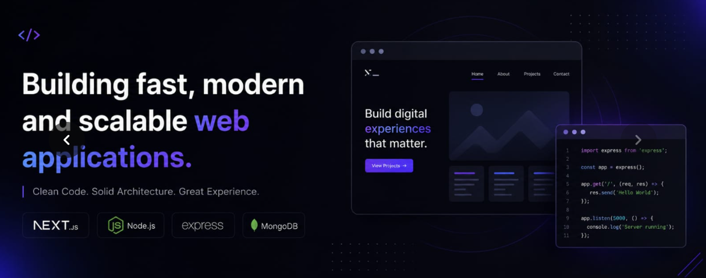

### Hey there, I'm Mou 👋

🎓 Web Development Trainee @ Programming Hero | Student @ Rangpur Ideal Institute of Technology (RIIT)

 Full-stack developer building real-world projects with **Next.js, Express, MongoDB**
 Long-term goal: becoming a **Data Scientist / AI Engineer**

---

-  Currently working on **Bengal Basket** — a food delivery platform built with Next.js
-  Recently shipped **BiblioDrop** — an online book delivery management system (Next.js 16, Express, MongoDB, Stripe, Better Auth)
- 🌱 Learning the fundamentals of Data Science & AI/ML alongside full-stack dev
- 💬 Ask me about Next.js, MongoDB, Auth, or deployment (Vercel/Render)
- 📫 Reach me: [LinkedIn](https://www.linkedin.com/in/kanich-fatimah-mou/) • [Email]
(kanichfatema@outlook.com)

---

 Tech Stack

**Frontend:**   

**Backend:**   

**Tools:**   

---

### 📊 GitHub Stats

